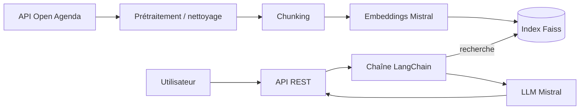

# **PROJET 9** - Concevoir et Déployer un système RAG

> Assistant intelligent de recommandation d'événements culturels

## 0 Setup du projet
```bash
poetry install
poetry env use python
```

## 1 Objectifs du projet

**Contexte**

_Présenter la mission confiée par Puls-Events._

**Problématique**

_En quoi un système RAG répond-il aux besoins métier ?_

**Objectif du POC**

_Ce que l'on cherche à démontrer : faisabilité technique, valeur métier, performance._

**Périmètre**

| Élément             | Valeur |
| ------------------- | ------ |
| Zone géographique   |        |
| Période d'événements |        |
| Données utilisées   |        |

## 2 Architecture du système

**Schéma global**



**Technologies utilisées**

| Composant           | Technologie              | Rôle |
| ------------------- | ------------------------ | ---- |
| Langage             | Python 3.12              |      |
| Gestion des dépendances | Poetry               |      |
| Source de données   | API Open Agenda          |      |
| Embeddings          | Mistral (`mistralai`)    |      |
| Base vectorielle    | Faiss (`faiss-cpu`)      |      |
| Orchestration LLM   | LangChain                |      |
| API                 | FastAPI / Flask          |      |

## 3 Préparation et vectorisation des données

**Source de données**

_API Open Agenda : paramètres utilisés, filtres appliqués._

**Nettoyage**

_Exemples d'anomalies corrigées, méthodes utilisées._

**Chunking**

_Raison du découpage, taille choisie._

**Embedding**

- Modèle utilisé :
- Dimensionnalité :
- Logique de batch :
- Format des vecteurs :

## 4 Choix du modèle NLP

**Modèle sélectionné**

**Pourquoi ce modèle ?**

_Critères : coût, qualité, compatibilité LangChain…_

**Prompting**

_Prompt de base / structure (voir [Annexes](#310-annexes))._

**Limites du modèle**

## 5 Construction de la base vectorielle

**Index Faiss utilisé**

**Stratégie de persistance**

- Format de sauvegarde :
- Nommage :

**Métadonnées associées**

_Ce qui est conservé pour chaque document._

## 6 API et endpoints exposés

**Framework utilisé** : FastAPI / Flask

**Endpoints clés**

| Méthode | Endpoint   | Description                              |
| ------- | ---------- | ---------------------------------------- |
| `POST`  | `/ask`     | Question utilisateur, réponse du système |
| `POST`  | `/rebuild` | Reconstruction de l'index (si besoin)    |

**Format des requêtes / réponses**

```jsonc
// Requête /ask

// Réponse /ask

```

**Exemple d'appel API**

```bash
curl -X POST http://localhost:8000/ask \
  -H "Content-Type: application/json" \
  -d '{"question": "..."}'
```

**Tests effectués et documentés**

**Gestion des erreurs / limitations**

## 7 Évaluation du système

**Jeu de test annoté**

- Nombre d'exemples :
- Méthode d'annotation :

**Métriques d'évaluation**

_Exemples : similarité sémantique, taux de couverture des réponses, score de satisfaction (subjectif)._

**Résultats obtenus**

- Analyse quantitative (scores globaux) :
- Analyse qualitative (exemples de bonnes / mauvaises réponses) :

## 8 Recommandations et perspectives

**Ce qui fonctionne bien**

**Limites du POC**

_Volumétrie, performance, coût, couverture thématique…_

**Améliorations possibles**

- Ajout de…
- Amélioration de…
- Passage en production via…

## 9 Organisation du dépôt GitHub

**Arborescence du dépôt**

```text
OC-RAG_System/
├── notebooks/
│   └── dataprocessing.ipynb
├── pyproject.toml
├── poetry.lock
└── README.md
```

**Explication des répertoires**

| Répertoire / fichier | Contenu |
| -------------------- | ------- |
| `notebooks/`         | Notebooks d'exploration et de préparation des données |
| `pyproject.toml`     | Configuration du projet et dépendances Poetry |

## 10 Annexes

**Extraits du jeu de test annoté**

**Prompt utilisé**

**Extraits de logs / exemples de réponse JSON**
